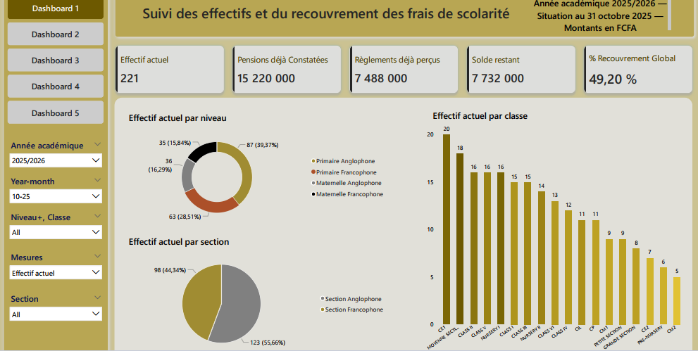
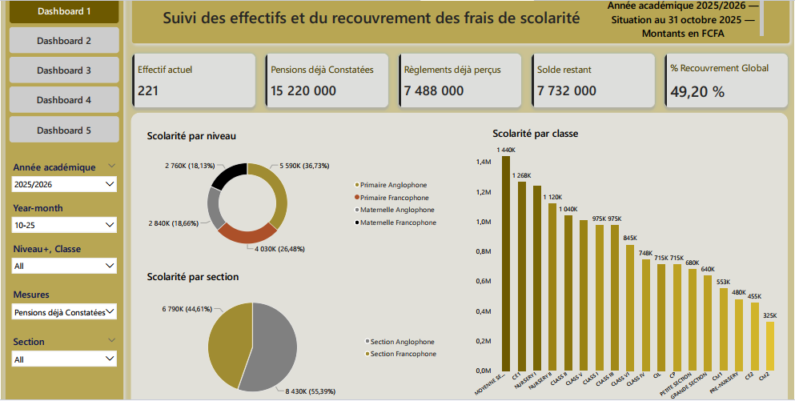
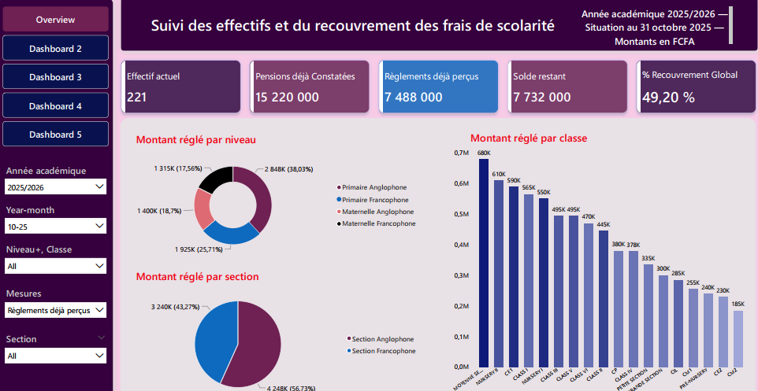
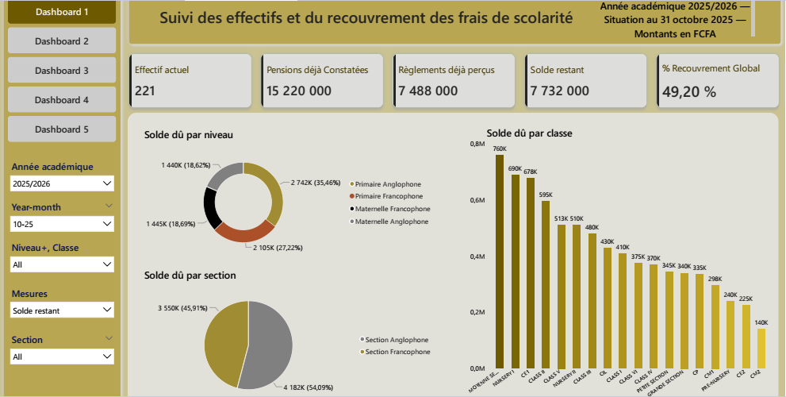
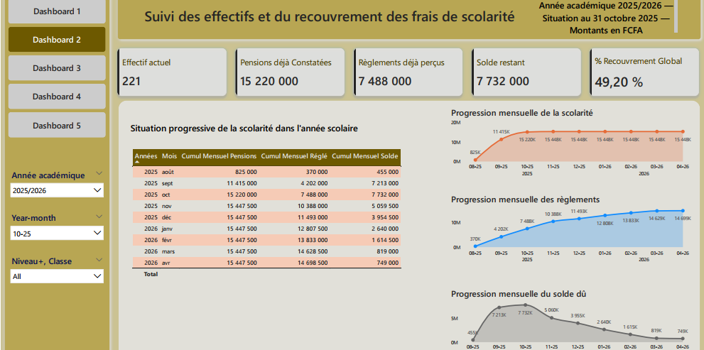

# Galerie du rapport Power BI

**Projet : Suivi des effectifs et du recouvrement des frais de scolarité**  
**Auteur : Brice Abogo**

[Retour à la présentation du projet](../README.md)

Cette galerie présente les différentes pages du rapport Power BI.

Le rapport comporte cinq dashboards. Dashboard 1 est présenté sous
quatre variantes, correspondant aux quatre indicateurs disponibles
dans le sélecteur « Mesures ».

Les captures sont statiques : les boutons, filtres et interactions
ne sont pas utilisables depuis GitHub.

Cliquez sur une capture pour ouvrir son fichier image.

---

## 1. Contexte des vues de synthèse

Les quatre captures de Dashboard 1 utilisent le même contexte :

| Paramètre | Sélection |
|---|---|
| Année académique | 2025/2026 |
| Year-month | 10-25 — octobre 2025 |
| Niveau / classe | Tous |
| Section | Toutes |
| Début du cumul académique | 1er août 2025 |
| Situation de référence | 31 octobre 2025 |
| Devise | FCFA |

La période disponible dans le rapport couvre août 2025 à avril 2026.
Les vues de synthèse présentées ici illustrent la situation de référence
d’octobre 2025, et non la totalité de cette période.

Le dernier mois disponible peut être incomplet.

---

## 2. Indicateurs affichés

Les cinq cartes de synthèse présentent les mêmes valeurs dans les
quatre captures :

| Indicateur | Valeur affichée |
|---|---:|
| Effectif actuel | 221 |
| Pensions déjà Constatées | 15 220 000 FCFA |
| Règlements déjà perçus | 7 488 000 FCFA |
| Solde restant | 7 732 000 FCFA |
| % Recouvrement Global | 49,20 % |

Le sélecteur « Mesures » permet de changer l’indicateur représenté
dans les graphiques par niveau, section et classe.

Les résultats des contrôles sont consignés séparément dans le
[journal de contrôle qualité](../docs/controle-qualite.md).
La galerie illustre le rendu du rapport ; elle ne remplace pas
les tests du modèle.

---

## 3. Dashboard 1 — Les quatre variantes

### 3.1. Effectif actuel

**Sélection dans « Mesures » : Effectif actuel**

Cette vue présente la répartition de l’effectif distinct cumulé :

- par niveau scolaire ;
- par section linguistique ;
- par classe.

Le libellé « Effectif actuel » désigne ici les comptes élèves distincts
ayant une constatation de scolarité entre le 1er août et le
31 octobre 2025.

Les 221 élèves ne constituent pas automatiquement un effectif
administratif vérifié au registre des inscriptions.

Cet indicateur est recalculé sur l’ensemble de la période :
il ne résulte pas de l’addition des effectifs mensuels.

### 3.2. Scolarité constatée

**Sélection dans « Mesures » : Pensions déjà Constatées**

Cette vue présente la répartition des frais de scolarité constatés
depuis le début du cycle académique jusqu’à la situation de référence.

Les graphiques permettent de comparer les montants par niveau,
section et classe.

Le montant cumulé affiché est de **15 220 000 FCFA**.

### 3.3. Règlements perçus

**Sélection dans « Mesures » : Règlements déjà perçus**

Cette vue présente la répartition des règlements cumulés sur
la même période académique.

Les graphiques permettent d’examiner la contribution de chaque niveau,
section et classe au total des règlements.

Le montant cumulé affiché est de **7 488 000 FCFA**.

### 3.4. Solde restant

**Sélection dans « Mesures » : Solde restant**

Cette vue présente la répartition de la différence entre les frais
de scolarité constatés et les règlements cumulés.

Le solde affiché est de **7 732 000 FCFA**, soit :

**15 220 000 − 7 488 000 = 7 732 000 FCFA**

Les graphiques permettent de comparer la répartition de ce solde
par niveau, section et classe.

Le solde restant, également intitulé « Solde dû » dans certains
graphiques, ne représente pas automatiquement une somme échue
ou un retard de paiement.

L’identification des retards nécessite les échéances applicables.

---

## 4. Dashboard 2 — Évolution mensuelle des cumuls

Cette page présente l’évolution cumulée de la scolarité constatée,
des règlements et du solde restant pour les mois disponibles
du cycle académique 2025/2026.

### Deux périmètres de lecture

Dans cette capture :

- les cinq cartes en haut de page présentent la situation de référence
  au **31 octobre 2025**, cumulée depuis le 1er août 2025 ;
- le tableau et les trois graphiques présentent l’évolution mensuelle
  disponible d’**août 2025 à avril 2026**.

La sélection « 10-25 » correspond donc à la situation de référence
des cartes, sans limiter ces visuels d’évolution à octobre.

### Valeurs affichées dans le tableau

Montants en FCFA.

| Mois | Scolarité constatée cumulée | Règlements cumulés | Solde restant |
|---|---:|---:|---:|
| Août 2025 | 825 000 | 370 000 | 455 000 |
| Septembre 2025 | 11 415 000 | 4 202 000 | 7 213 000 |
| **Octobre 2025** | **15 220 000** | **7 488 000** | **7 732 000** |
| Novembre 2025 | 15 447 500 | 10 388 000 | 5 059 500 |
| Décembre 2025 | 15 447 500 | 11 493 000 | 3 954 500 |
| Janvier 2026 | 15 447 500 | 12 807 500 | 2 640 000 |
| Février 2026 | 15 447 500 | 13 833 000 | 1 614 500 |
| Mars 2026 | 15 447 500 | 14 628 500 | 819 000 |
| Avril 2026 | 15 447 500 | 14 698 500 | 749 000 |

Les étiquettes des graphiques utilisent des montants abrégés et
arrondis. Le tableau ci-dessus reprend les montants entiers affichés.

### Lecture des cumuls

Chaque ligne représente une situation cumulée depuis le début
du cycle académique, à partir des écritures chargées.

Les cumuls se poursuivent en janvier : ils ne sont pas remis à zéro
au changement d’année civile.

Il ne faut pas additionner les cumuls des différentes lignes pour
obtenir un total annuel.

Le solde restant correspond à la différence entre la scolarité
constatée et les règlements cumulés. Le titre « Solde dû » utilisé
dans le graphique ne signifie pas que toutes les sommes sont échues.

### Limite de disponibilité

La ligne d’avril 2026 reflète les écritures disponibles dans les
données chargées. Elle ne démontre pas que le mois d’avril est complet.

---

## 5. Conventions de lecture

- Les montants sont exprimés en FCFA.
- Dans les graphiques, « K » représente des milliers et « M »
  des millions.
- Certaines étiquettes graphiques sont arrondies.
- Le taux de recouvrement correspond aux règlements cumulés
  divisés par la scolarité constatée cumulée.
- Les captures montrent un état du rapport avec des filtres précis ;
  elles ne permettent pas de tester ses interactions.

---

## 6. Autres pages du rapport — Captures à ajouter

La galerie sera complétée progressivement avec les pages suivantes :

| Page | Contenu |
|---|---|
| Dashboard 3 | Détails mensuels par niveau et classe, accompagnés des tendances |
| Dashboard 4 | Situation individuelle — version de démonstration entièrement synthétique |
| Dashboard 5 | Suivi journalier — version de démonstration entièrement synthétique |

Pour les dashboards 4 et 5, les lignes de démonstration sont entièrement
synthétiques, conformément à la confirmation de l’auteur :
elles ne reproduisent aucune situation individuelle réelle.

Cette distinction concerne la version de présentation de ces pages.
Elle ne requalifie pas les données sources décrites dans la
documentation du projet.

---

## Documentation associée

- [Présentation générale](../README.md)
- [Dictionnaire des données](../docs/dictionnaire-donnees.md)
- [Journal de contrôle qualité](../docs/controle-qualite.md)
- [Mesures DAX](../dax/README.md)
- [Confidentialité](../docs/confidentialite.md)
